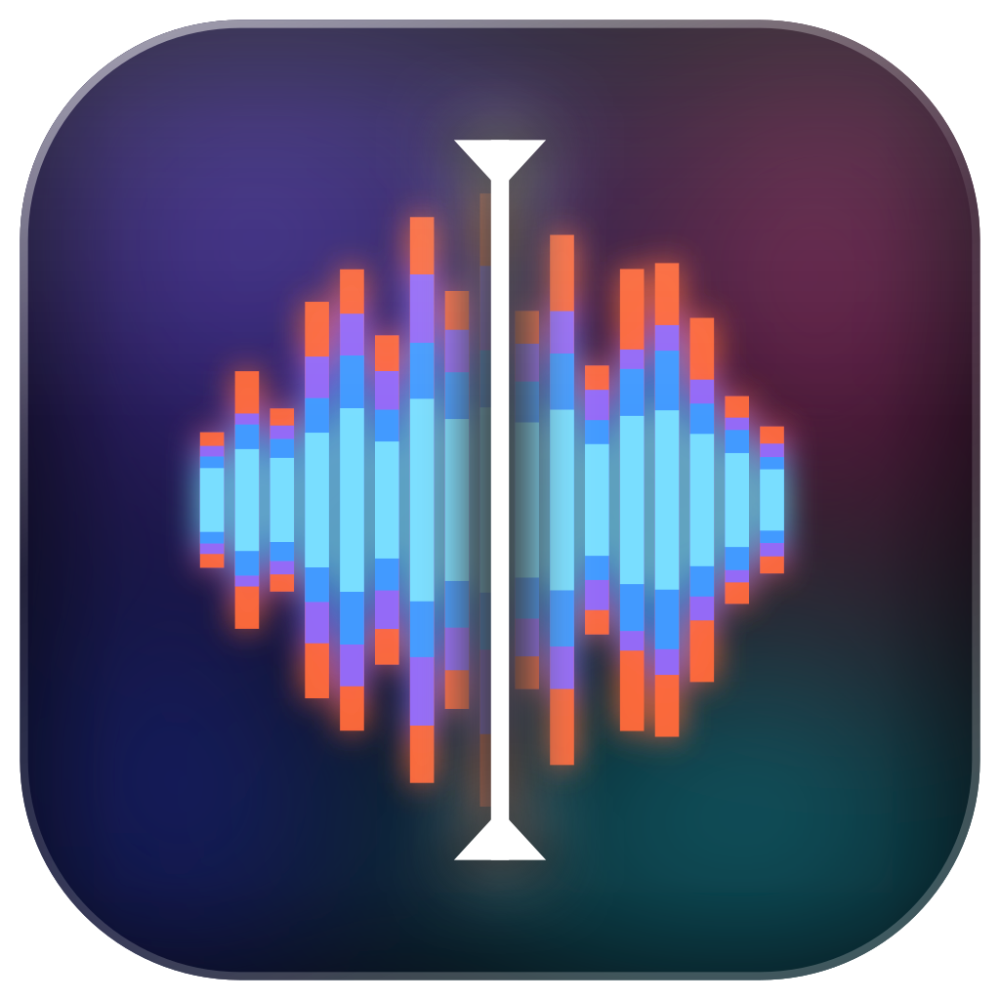
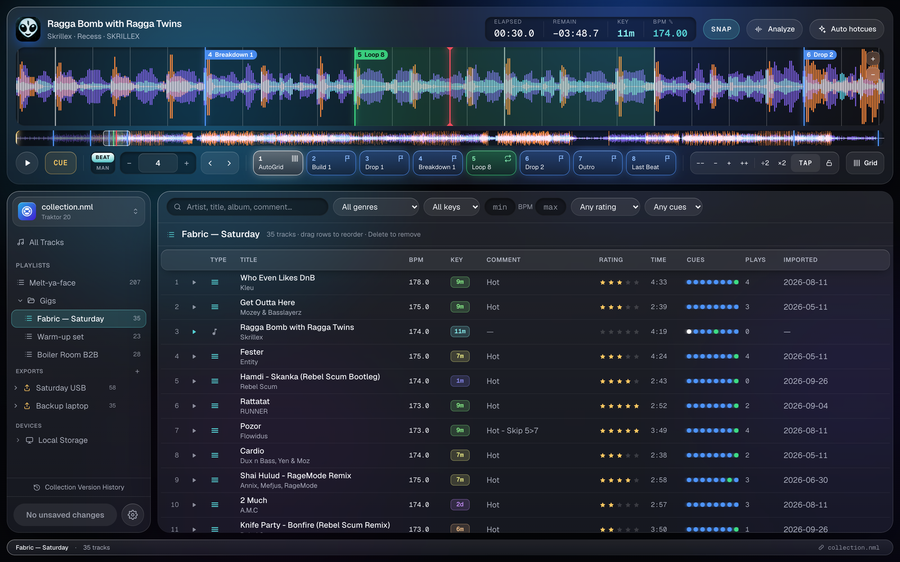
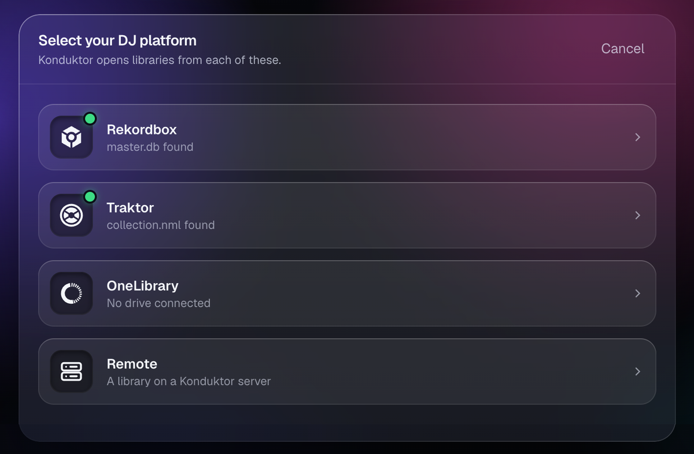
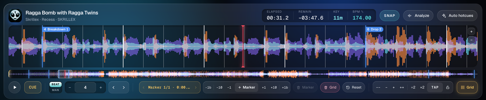
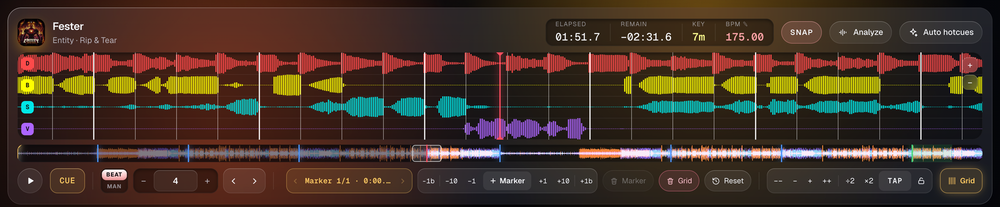
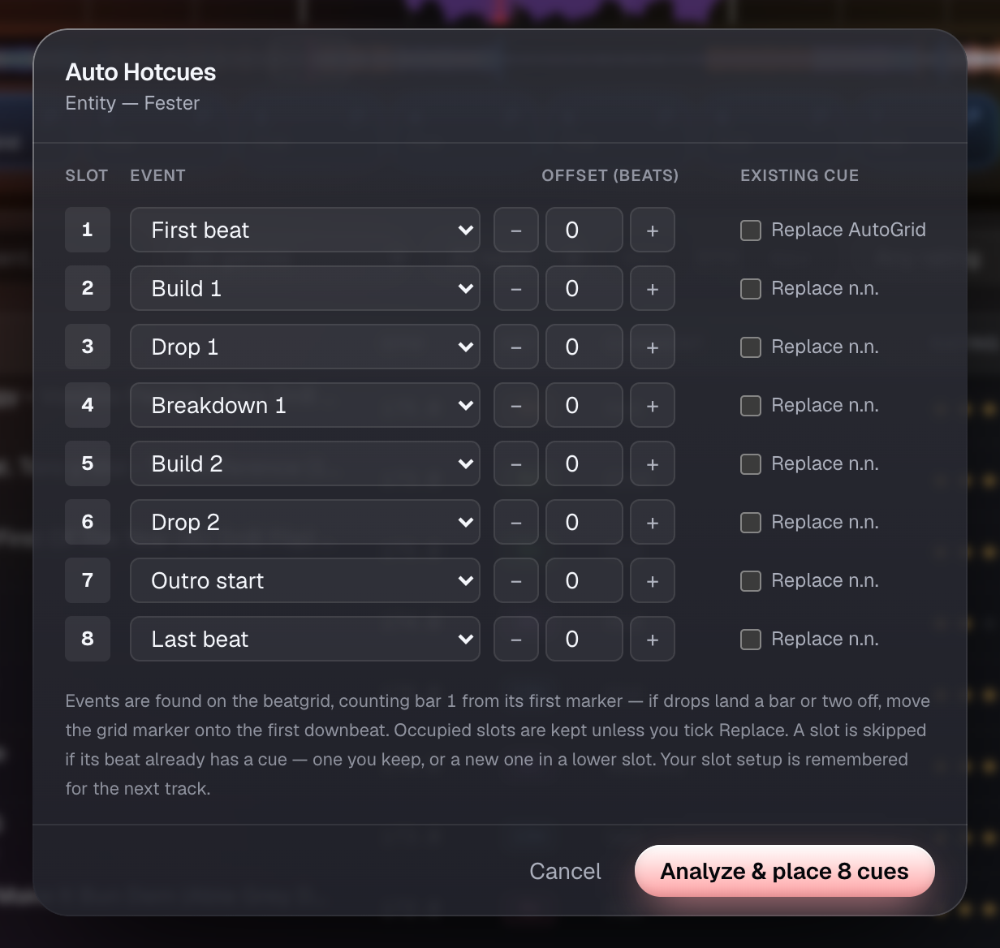
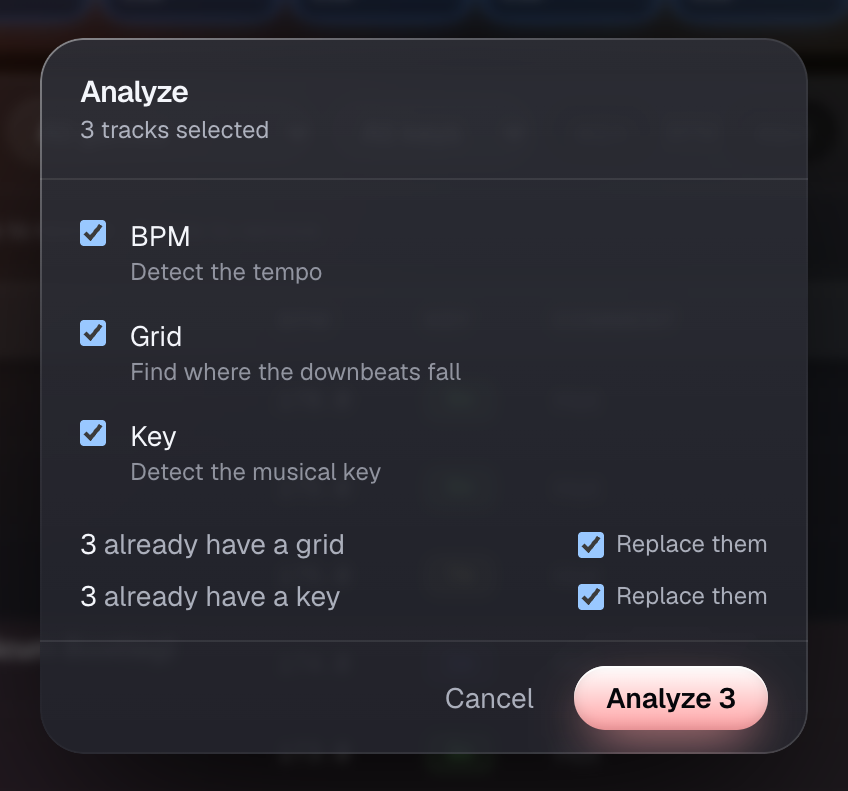
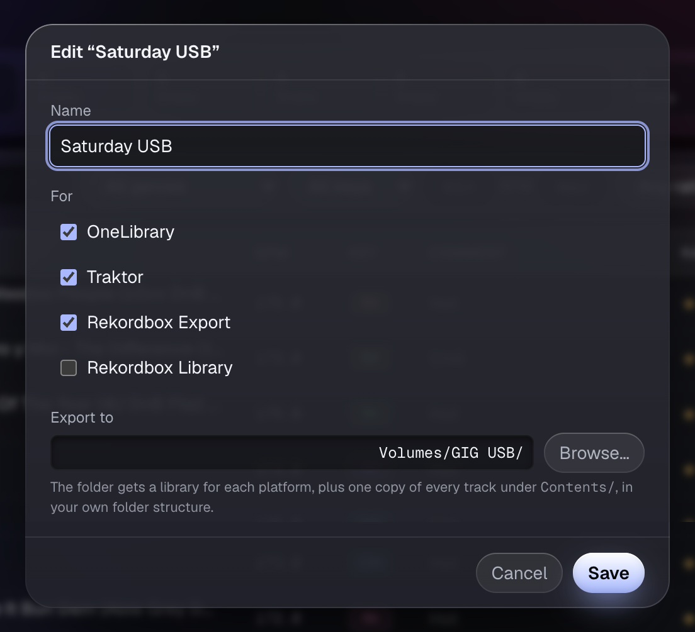

  

<h1 align="center">Konduktor</h1>

  <b>Prep your tracks and run your DJ libraries in one fast app.</b> 
  Traktor, Rekordbox, or the USB stick in your pocket.

  <a href="https://github.com/MrPatben8/konduktor/releases"><b>Download for macOS & Windows</b></a>

Konduktor opens the library you already have, in the format it already uses.
You can tidy tags, build playlists, set grids and cues, and pack a USB stick
for the gig without launching your full DJ software. When you open your DJ
software again, everything you changed is there.

---

## One app for every library

- **Traktor** collections.
- **Rekordbox** libraries.
- **OneLibrary** USB sticks, the format CDJs read. Plug one in to browse it,
  preview tracks off it, import them, or edit the stick directly.
- **Remote** libraries: keep your whole library and music on a home server and
  open it from any laptop ([set up a server](docs/REMOTE-SERVER.md)).
- **Any folder or drive**: browse loose audio files, preview them, and add
  them to your library.

Your library is never converted into a Konduktor database. Saves write back to
the original file and change only what you edited.

 

## A real prep deck

- A scrolling waveform, coloured by frequency, with zoom, scratching and an
  overview of the whole track.
- Eight hotcue pads with names, types and colours, plus beat loops, beat jump
  and tap tempo.
- **Beatgrid editing**, including grids with tempo changes. Nudge, retempo,
  halve or double without opening your DJ software.
- Keyboard shortcuts for the whole deck: Space to play, 1–8 for hotcues,
  arrow keys to jump or move a loop.

## Stems, built in

**Play stem files as stems.** Load a stem file and the deck splits into
drums, bass, synths and vocals, each drawn in its own lane. Click a lane's
button to mute it, Alt/Option-click to solo it, or use Q W E R.

**Convert to Stems.** In a Traktor collection, right-click any tracks and
choose Convert to Stems. They come back as standard Traktor stem files with their tags, cover art, cues and
beatgrid intact.

- The separation runs on your own computer, so your music isn't sent to an
  online service.
- Replace the originals, or save the stems to a folder and add them as new
  tracks.
- Convert a whole playlist in one go.

## Let it do the boring parts

| Auto Hotcues | Analyze |
|:---:|:---:|
|  |  |
| Pick an event for each pad (first beat, build, drop, breakdown, outro). Konduktor finds them in the track and places the cues. Run it on one track or a whole playlist. | Detects tempo, beatgrid and musical key, for one track or hundreds. |

## Export to USB for CDJs, or other platforms

Make an **export** in the sidebar, drag playlists onto it, and press Export.
One stick can carry a Traktor collection, a OneLibrary library for current
CDJs and a Rekordbox Device Library for older players, all sharing **one copy
of the audio**.

- Hotcues, memory cues, loops, grids, keys and cover art are converted for
  each platform.
- Playlists stay linked: edit a playlist, re-export, and the stick catches up.
- Re-exports copy only what changed, so updating a stick is quick.
- Konduktor only ever clears a folder that it wrote itself.

 

## Your library is safe

- **Saves are surgical.** A Traktor save changes only the entries you edited.
  The rest of the file stays byte-for-byte identical.
- **Backups and history.** Every Traktor save makes a backup first and is kept
  in a version history that you can restore from in the app.
- **Nothing is written until you press Save.** Discard changes throws away
  everything you did since your last save.
- Tag edits are also written into the audio files themselves, so other apps
  see them too.

## And also

- A fast library with search, filters, sorting and columns you can rearrange,
  even with thousands of tracks.
- Edit tags inline or in a full tag and cover-art editor.
- Drag and drop tracks onto playlists, exports or the deck, and drag playlists
  to reorganise them.
- If you open a Traktor collection on a different computer or drive,
  Konduktor finds the missing files for you.

---

## Get Konduktor

Download the latest build from
[**Releases**](https://github.com/MrPatben8/konduktor/releases):
a `.dmg` for macOS (Apple Silicon) and a `-setup.exe` for Windows.

> **First launch:** builds aren't notarised yet, so your OS will warn you the
> first time.
> **macOS:** right-click the app, choose **Open**, then **Open** again. If it
> still refuses, run `xattr -cr /Applications/Konduktor.app` once.
> **Windows:** click **More info → Run anyway**.

> **Using Traktor?** Close it before saving in Konduktor. Traktor rewrites
> `collection.nml` when it quits, which would overwrite your changes.

Want to run it from source or build it yourself? See
[docs/BUILDING.md](docs/BUILDING.md).

## License

[AGPL-3.0](LICENSE)
